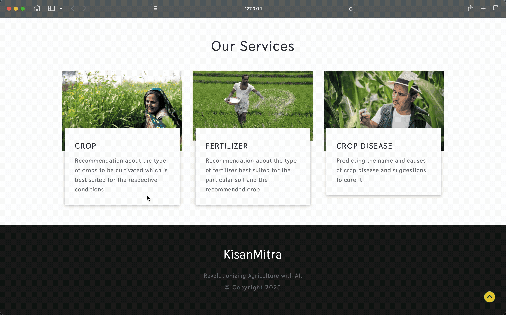
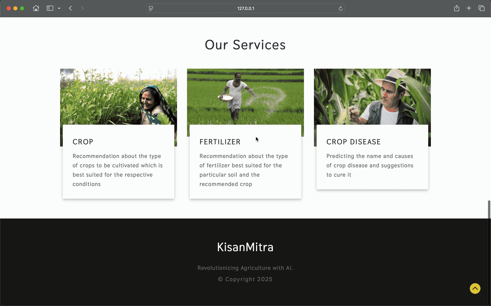
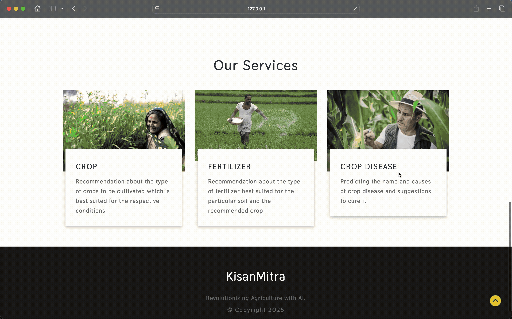

# 🌾 KISAN MITRA – AI Powered Farming Assistant


A complete AI and ML-based web application that helps farmers with **Crop Recommendation**, **Fertilizer Suggestion**, and **Plant Disease Detection** — all in one simple-to-use platform.

---

## 🚨 DISCLAIMER ⚠️

This project is a **Proof of Concept (POC)** built for educational purposes. Data used is from public sources and should not be used for actual farming decisions without proper validation. It showcases how AI can be leveraged for **precision agriculture** at scale.

---

## 💡 MOTIVATION

Agriculture supports millions of livelihoods, especially in India. This project empowers farmers by:
- 📊 **Recommending the most suitable crops** based on soil and climate data.
- 💡 **Suggesting fertilizers** to improve soil health.
- 🌱 **Detecting plant diseases** from leaf images using Deep Learning.

---

## 📊 DATA SOURCES

- [Crop Recommendation Dataset](https://www.kaggle.com/atharvaingle/crop-recommendation-dataset)
- [Fertilizer Dataset (custom)](link-if-applicable)
- [Plant Disease Dataset (PlantVillage)](https://www.kaggle.com/vipoooool/new-plant-diseases-dataset)

---

## 📌 FEATURES

### ✅ Crop Recommendation
Predicts suitable crops based on soil nutrients (N, P, K), pH, rainfall, temperature, and humidity.

### ✅ Fertilizer Suggestion
Recommends fertilizers based on nutrient deficiencies or excesses in soil for a given crop.

### ✅ Disease Detection
Detects diseases from uploaded plant leaf images using CNN models and suggests remedies.

<details>
<summary>Supported Crops for Disease Detection</summary>

- Apple, Blueberry, Cherry, Corn, Grape, Peach, Pepper, Potato, Soybean, Strawberry, Tomato

</details>

---

## 🛠️ TECH STACK

| Category | Tools & Technologies |
|-----------|-----------------------|
| **Backend** | Python, FastAPI, scikit-learn, TensorFlow/Keras, OpenCV |
| **Frontend** | HTML, CSS, JavaScript |
| **Database** | CSV files, PostgreSQL (optional) |
| **Deployment** | Render, Heroku / AWS EC2 (optional) |
| **Utilities** | pandas, NumPy, matplotlib, seaborn, Postman |

---

## 🚀 DEPLOYMENT

- FastAPI backend with ML/DL models.
- Simple HTML/CSS/JS frontend.
- Deployed on **Render**: [https://kisan-mitra-9fzk.onrender.com](https://kisan-mitra-x2wr.onrender.com)
- API endpoints tested via Postman.

---

## 🖥️ LOCAL SETUP GUIDE

### Prerequisites:
- [Git](https://git-scm.com/), [Python 3.8+](https://www.python.org/), [pip](https://pip.pypa.io/en/stable/)

### Setup Steps:
```bash
git clone https://github.com/your-username/Kisan-Mitra.git
cd Kisan-Mitra
python -m venv venv
source venv/bin/activate  # Windows: venv\Scripts\activate
pip install -r requirements.txt
uvicorn app:app --reload
```
Visit: [http://127.0.0.1:8000](http://127.0.0.1:8000)

---

## 🔬 REAL-WORLD EVALUATION

The disease model reaches 99.2% validation accuracy, but validation and test images come from the same PlantVillage source as the training data. To check real-world behaviour it was scored on 215 in-field photos from the PlantDoc test split (25 matching classes, 4-12 images each; CC-BY-4.0, see `real_images/SOURCES.md`).

| Preprocessing | Exact label | Right crop | Avg confidence when wrong | Wrong with >=90% confidence |
|---|---|---|---|---|
| app (Resize 256, original app.py) | 27/212 (13%) | 31% | 76% | 67/185 |
| square (Resize 256x256) | 20/215 (9%) | 23% | 73% | 54/195 |

Takeaways: accuracy drops sharply on field photos, and the model is often confident when wrong, so its confidence should not be treated as reliability. The numbers above were measured before two input-handling crashes in `predict_image` (non-RGB images and non-square images) were fixed.

Details, confusion table and example images: [notebooks/real_world_eval.ipynb](notebooks/real_world_eval.ipynb). Reproduce with `python real_world_eval.py` from the repo root.

## 💻 USAGE

- ✅ **Crop Recommendation**: Input N, P, K, pH, rainfall, temperature, humidity → get best crop.
- ✅ **Fertilizer Suggestion**: Input soil data + crop → get fertilizer advice.
- ✅ **Disease Detection**: Upload plant leaf image → get diagnosis and remedy.

---

## 🌐 DEMO 

| Feature             | Preview                                                                                     |
|---------------------|---------------------------------------------------------------------------------------------|
| Crop Recommendation    |  |
| Fertilizer Suggestion  |  |
| Disease Detection      |  |


---

## ✅ FUTURE SCOPE

- Larger datasets for regional accuracy
- Multi-language support
- Real-time weather API integration
- Mobile-responsive design

---

## 🤝 CONTRIBUTIONS

Pull requests are welcome. For significant changes, open an issue first to discuss ideas.

---

## 📜 LICENSE

Licensed under **MIT License** – See [LICENSE](LICENSE).

---

## 📞 CONTACT

- 📧 Email: priyanshbhatt164@gmail.com
- 💼 LinkedIn: [Priyansh's LinkedIn](https://linkedin.com/in/priyansh-bhatt09)
- ⭐ GitHub: [Priyansh's GitHub](https://github.com/Priyansh_Cooks)

---
